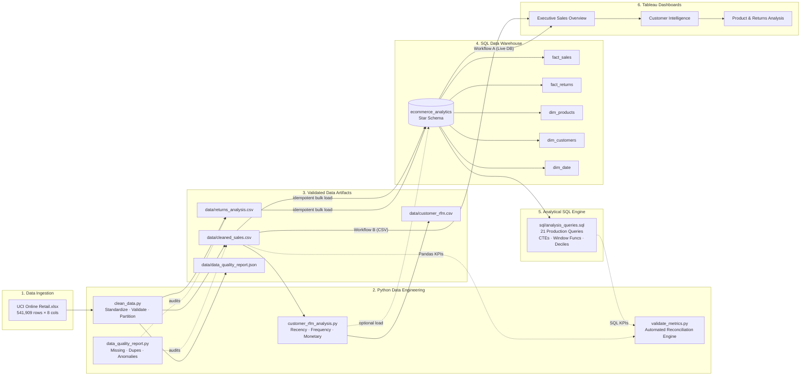

# E-Commerce Sales Intelligence & Customer Behavior Analytics

[](https://www.python.org/)
[](https://www.mysql.com/)
[](https://public.tableau.com/)
[](https://opensource.org/licenses/MIT)

An end-to-end data analytics and business intelligence pipeline built on the **UCI Online Retail** dataset (541,909 transactions). This project ingests raw uncleaned transactional spreadsheets, performs automated data validation and quality auditing in Python, loads a dimensional star schema into MySQL/PostgreSQL via SQLAlchemy 2, executes 21 advanced analytical SQL queries (CTEs, window functions), segments customers using a 10-tier RFM heuristic model, reconciles metrics through automated cross-validation, and provides comprehensive blueprints for 3 interactive Tableau dashboards.

---

## 🏗️ End-to-End Pipeline Architecture



---

## 📂 Project Repository Structure

```
ecommerce-sales-analytics/
│
├── data/                                 ← Data repository
│   ├── Online Retail.xlsx                ← Raw dataset from UCI (download manually)
│   ├── cleaned_sales.csv                 ← Validated eligible sales transactions
│   ├── returns_analysis.csv              ← Cancellations, returns, and adjustments
│   ├── customer_rfm.csv                  ← Customer-level RFM metrics and segments
│   ├── data_quality_report.json          ← Automated quality audit log
│   └── metrics_validation_report.json    ← Pandas vs SQL reconciliation report
│
├── python/                               ← Python pipeline modules
│   ├── config.py                         ← Shared configuration, paths, and DB URLs
│   ├── clean_data.py                     ← Ingestion, standardization, and splitting
│   ├── data_quality_report.py            ← Anomaly detection and quality auditing
│   ├── load_database.py                  ← Idempotent star-schema loader (SQLAlchemy 2)
│   ├── customer_rfm_analysis.py          ← RFM scoring & 10-tier customer segmentation
│   └── validate_metrics.py               ← Automated cross-validation tolerance engine
│
├── sql/                                  ← Database scripts
│   ├── create_database.sql               ← Database creation script (MySQL/Postgres)
│   ├── create_tables.sql                 ← Star-schema DDL (facts, dims, FKs, indexes)
│   └── analysis_queries.sql              ← 21 production analytical SQL queries
│
├── tableau/                              ← Tableau specifications
│   └── dashboard_build_guide.md          ← Exact visual blueprint for all 3 dashboards
│
├── report/                               ← Formal MCA academic deliverables
│   └── project_report.md                 ← 24-section comprehensive MCA project report
│
├── screenshots/                          ← Visual artifacts for report & presentation
│   ├── dashboard1_executive_overview.png ← Executive sales overview screenshot
│   ├── dashboard2_customer_intel.png     ← Customer intelligence dashboard screenshot
│   └── dashboard3_product_returns.png    ← Product & returns analysis screenshot
│
├── logs/                                 ← Application execution logs
│   └── pipeline.log                      ← Consolidated pipeline execution log
│
├── .env.example                          ← Database credentials template
├── .gitignore                            ← Version control exclusion rules
├── requirements.txt                      ← Pinned Python dependencies
└── README.md                             ← Project overview and documentation
```

---

## ⚙️ Quick Start & Setup Guide

### Prerequisites
- **Python**: Version 3.10, 3.11, or 3.12
- **Database**: MySQL 8.0+ or PostgreSQL 14+
- **BI Tool**: Tableau Desktop or Tableau Public (free)
- **OS**: Windows PowerShell (tested on Windows 10/11)

### 1. Environment Installation
Open PowerShell in the project directory:

```powershell
# Navigate to project root
cd "c:\Users\panka\Desktop\data analytics\ecommerce-sales-analytics"

# Create virtual environment
python -m venv venv

# Activate virtual environment
.\venv\Scripts\Activate.ps1

# Upgrade pip and install pinned dependencies
python -m pip install --upgrade pip
pip install -r requirements.txt
```

### 2. Configure Database Credentials
Copy `.env.example` to `.env` and enter your database credentials:

```powershell
Copy-Item .env.example .env
```

Edit `.env`:
```ini
DB_ENGINE=mysql
DB_HOST=localhost
DB_PORT=3306
DB_USER=root
DB_PASSWORD=your_secure_password
DB_NAME=ecommerce_analytics
```

### 3. Obtain Dataset
Place `Online Retail.xlsx` into `data/`. If you do not have it, run:

```powershell
Invoke-WebRequest -Uri "https://archive.ics.uci.edu/static/public/352/online+retail.zip" -OutFile "data\online_retail.zip"
Expand-Archive -Path "data\online_retail.zip" -DestinationPath "data\" -Force
```

---

## 🚀 Pipeline Execution Sequence

Execute the pipeline in this exact order:

```powershell
# 1. Clean raw Excel data and partition into sales and returns
python python/clean_data.py

# 2. Run data quality audit and export JSON summary
python python/data_quality_report.py

# 3. Create tables and load dimensional warehouse idempotently
python python/load_database.py --create-tables

# 4. Execute analytical SQL queries
mysql -u root -p ecommerce_analytics < "sql\analysis_queries.sql"

# 5. Compute customer RFM segmentation and load to database
python python/customer_rfm_analysis.py --load-db

# 6. Run automated cross-validation audit
python python/validate_metrics.py --strict
```

---

## 📊 Tableau Dashboards

Complete step-by-step build instructions, calculated fields, and shelf placements are documented in [tableau/dashboard_build_guide.md](file:///c:/Users/panka/Desktop/data%20analytics/ecommerce-sales-analytics/tableau/dashboard_build_guide.md).

### 1. Executive Sales Overview

- **Audience:** C-Suite & Commercial Leadership
- **Key Visuals:** KPI Scorecard Cards, Monthly Revenue Dual-Axis Trend (navy bars + coral line), Geographic Choropleth Sales Map, Top 10 Revenue Products, and Weekly Peak Traffic Heatmap.

### 2. Customer Intelligence & Behavior

- **Audience:** Chief Marketing Officer & Retention Strategists
- **Key Visuals:** Retention Health KPIs, 10-Tier RFM Segment Treemap, Log-scale Value vs Frequency Scatter Matrix, 100% Stacked New vs Repeat Cohort Trend, and Order Frequency Distribution.

### 3. Product Intelligence & Returns Analysis

- **Audience:** Category Managers & Supply Chain Leads
- **Key Visuals:** Return Loss KPIs, 4-Quadrant Product Matrix (Core Cash Cows, Quality Alerts, Discontinue Candidates, Niche SKUs), Return Reason Breakdown, and Pareto 80/20 Revenue Curve.

---

## 🛠️ Troubleshooting & Common Issues

| Issue / Error | Likely Cause | Verified Solution |
|---|---|---|
| `PSSecurityException: UnauthorizedAccess` | PowerShell execution policy restricts scripts. | Run once as Admin: `Set-ExecutionPolicy RemoteSigned -Scope CurrentUser`. |
| `FileNotFoundError: Online Retail.xlsx` | Dataset missing in `data/`. | Download and place `Online Retail.xlsx` directly into `data/`. |
| `OperationalError: Access denied for user` | Invalid MySQL credentials in `.env`. | Verify `.env` credentials match your local database instance. |
| `BinEdgeError: Bin edges must be unique` | Duplicate values in RFM quantile calculation. | Handled automatically in `customer_rfm_analysis.py` using rank-based binning (`rank(method='first')`). |
| `Join Fanout / Inflated Revenue in Tableau` | Physical join performed between sales and returns. | Connect using Tableau's **Logical Layer (Relationships / Noodles)** on `customer_id` or `stock_code`. |
| `Can't connect to MySQL server on 'localhost'` | MySQL service is stopped. | Open Services (`services.msc`) and start `MySQL80` (or `net start mysql80`). |

---

## 📄 License
This project is developed for educational and portfolio demonstration purposes as part of the Master of Computer Applications (MCA) curriculum. Licensed under the [MIT License](LICENSE).
