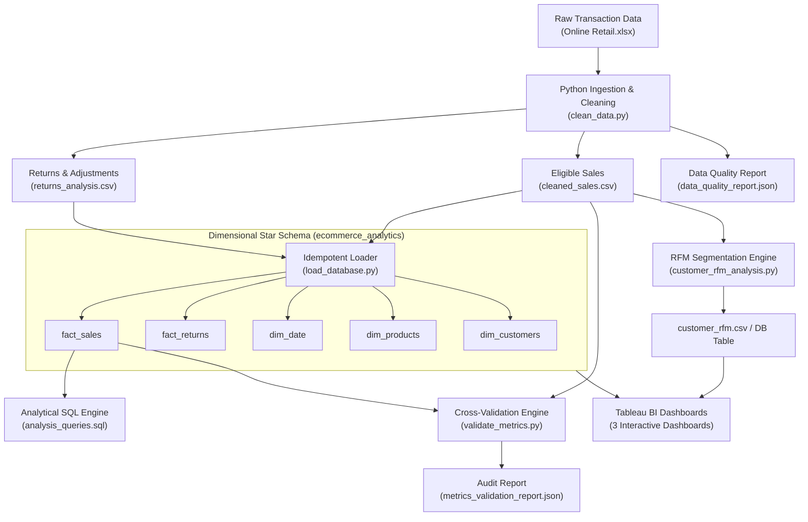
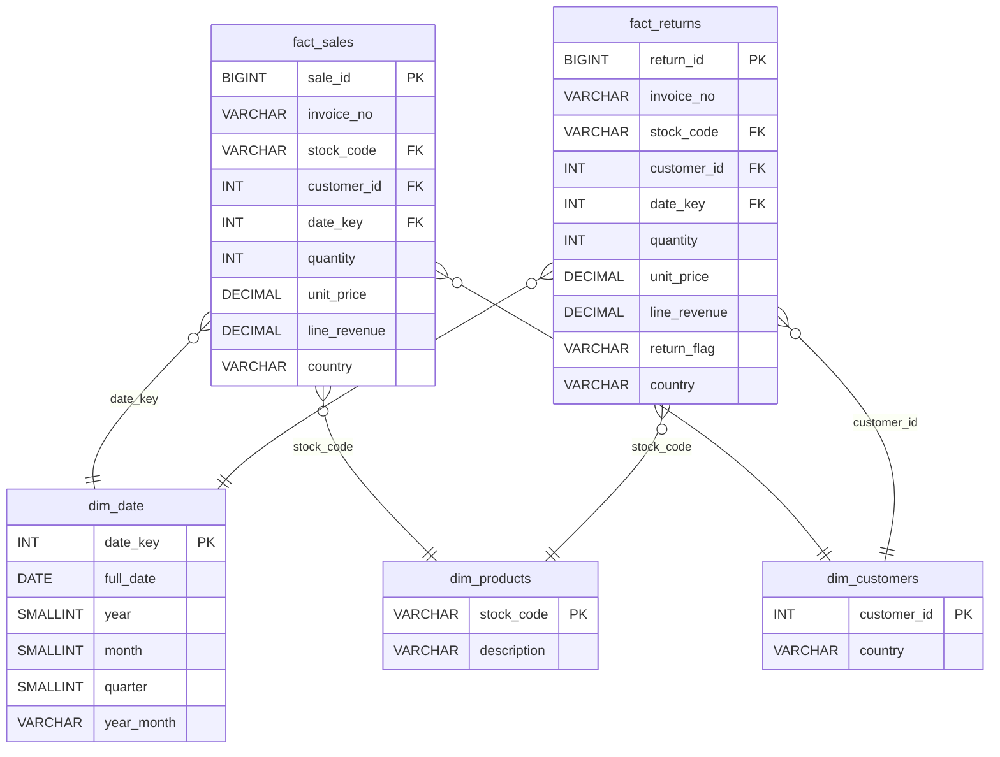
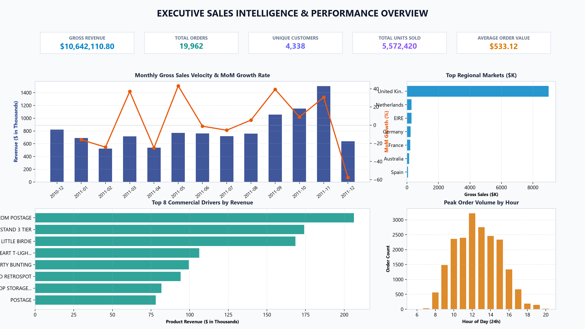
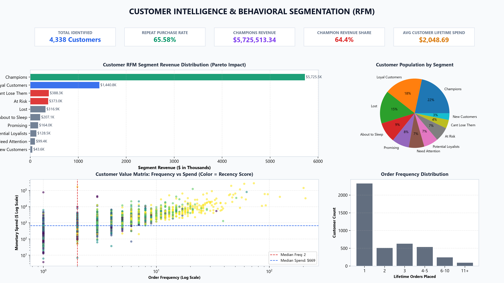
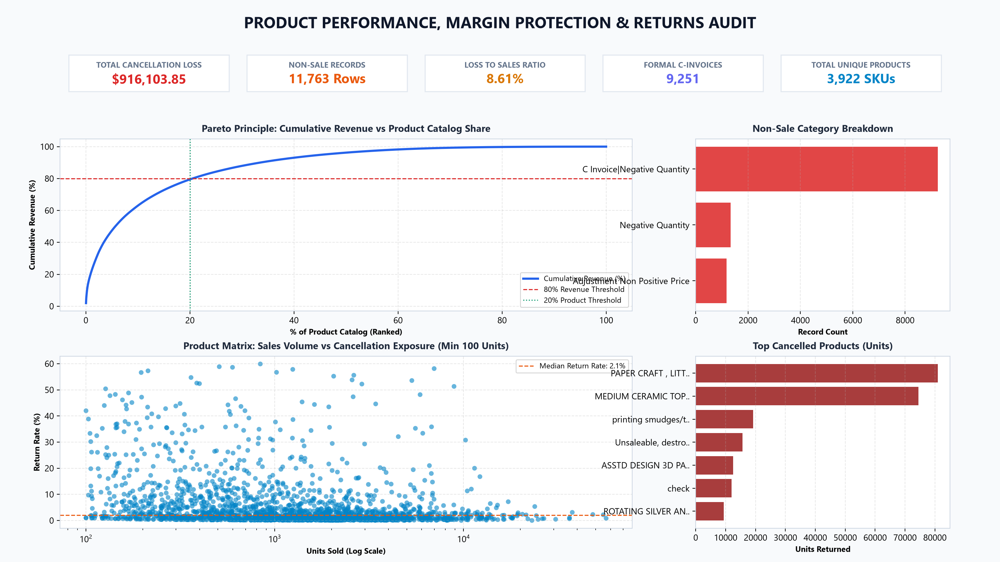

# Master of Computer Applications (MCA) Mini Project Report
## E-Commerce Sales Intelligence & Customer Behavior Analytics

---

### Section 1: Title Page & Project Metadata

- **Project Title:** E-Commerce Sales Intelligence & Customer Behavior Analytics: An End-to-End Dimensional Modeling, RFM Segmentation, and Business Intelligence Pipeline
- **Domain:** Data Analytics, Data Engineering, Business Intelligence
- **Primary Tools & Technologies:** Python 3.10+, Pandas, NumPy, SQLAlchemy 2.0, MySQL 8.0 / PostgreSQL 14+, Tableau Desktop / Tableau Public, Git
- **Candidate Name:** *[Student Name]*
- **Roll Number / Registration Number:** *[Roll Number]*
- **Degree:** Master of Computer Applications (MCA)
- **Department:** Department of Computer Applications / Information Technology
- **Institution:** *[University / Institute Name]*
- **Academic Year:** 2025–2026

---

### Section 2: Certificate of Authenticity

*This is to certify that the project entitled **"E-Commerce Sales Intelligence & Customer Behavior Analytics"** submitted by **[Student Name]** (Roll No: **[Roll Number]**) in partial fulfillment of the requirements for the award of the degree of **Master of Computer Applications (MCA)** is an authentic record of independent project work carried out under my supervision and guidance.*

*To the best of my knowledge, the matter embodied in this report has not been submitted elsewhere for the award of any other degree, diploma, or certificate.*

**Project Guide / Mentor:**  
*[Guide Name]*, *[Designation]*  
Department of Computer Applications  
*[Institution Name]*  

**Head of Department (HOD):**  
*[HOD Name]*, *[Designation]*  
Department of Computer Applications  
*[Institution Name]*  

---

### Section 3: Candidate Declaration

*I hereby declare that the project work presented in this report entitled **"E-Commerce Sales Intelligence & Customer Behavior Analytics"** is an authentic record of my own work conducted under the mentorship of **[Guide Name]**.*

*I have adhered to all academic integrity standards. All external libraries, references, algorithms, and datasets utilized in this study have been explicitly cited and acknowledged.*

**Date:** *[Current Date]*  
**Place:** *[City / Campus]*  
**Candidate Signature:** ___________________________  
**[Student Name]**

---

### Section 4: Acknowledgments

*I express my deepest gratitude to my project mentor, **[Guide Name]**, for invaluable technical guidance, constructive reviews, and continuous encouragement throughout the conception, architecture, and execution of this data pipeline.*

*I extend my sincere thanks to the Department of Computer Applications and the faculty members of **[Institution Name]** for providing the infrastructural computing facilities and learning environment that made this project possible.*

*Finally, I thank my family, peers, and fellow students for their steadfast support and collaboration throughout this endeavor.*

---

### Section 5: Abstract / Executive Summary

Modern e-commerce enterprises generate massive volumes of transactional data across disparate channels. However, raw transactional logs frequently suffer from data quality anomalies, including cancellation proxies, missing identifiers, irregular pricing, duplicate entries, and inconsistent temporal timestamps. This project designs, implements, and validates an enterprise-grade data intelligence pipeline on the **UCI Online Retail dataset** (541,909 records).

The pipeline introduces an automated Python-based data engineering layer that performs data cleaning, anomaly isolation, and conservative partitioning into eligible sales ($Q > 0 \land P > 0 \land \neg \text{C\_invoice}$) and return proxies. Cleaned data is loaded idempotently into an optimized **Kimball star-schema data warehouse** (`ecommerce_analytics`) hosted on MySQL 8.0 via SQLAlchemy 2. A suite of 21 production SQL analytical queries—leveraging Common Table Expressions (CTEs), window functions (`RANK`, `DENSE_RANK`, `NTILE`, `LAG`, `PERCENT_RANK`), and conditional aggregation—uncovers deep business patterns across temporal, geographic, product, and cohort dimensions.

Furthermore, a customer-level **Recency, Frequency, and Monetary (RFM)** model is engineered using rank-based quintile scoring, mapping identified shoppers into 10 actionable business heuristic segments. An automated cross-validation engine enforces mathematical reconciliation between Pandas in-memory metrics and SQL warehouse tables within strict numerical tolerances ($\le 0.01\%$). Finally, comprehensive blueprints for three interactive **Tableau Business Intelligence dashboards** (Executive Overview, Customer Intelligence, Product & Returns Analysis) are constructed to provide decision-makers with actionable operational visibility.

---

### Section 6: Introduction & Problem Statement

#### 6.1 Context
In the global digital retail economy, transaction volume and customer acquisition costs continue to rise. E-commerce leadership requires real-time, trustworthy analytics to optimize inventory velocity, prevent customer churn, identify margin leakage from returns, and tailor promotional spend.

#### 6.2 Problem Statement
Raw transactional datasets downloaded from ERP and payment gateways are inherently dirty and unstandardized:
1. **Cancellation & Adjustment Conflation:** Orders marked with cancellation prefixes (`C`) or negative quantities are frequently commingled with gross sales, skewing revenue metrics.
2. **Missing Customer Identifiers:** Guest checkouts account for substantial transaction volumes (~25%), creating analytical traps where naive filtering drops revenue, or naive joins corrupt customer retention rates.
3. **Join Duplication in Reporting:** Relational joins between sales line items and return records often cause cartesian fanout, artificially multiplying sales revenue in BI tools.
4. **Lack of Automated Data Integrity Audits:** Organizations rarely reconcile in-memory Python transformations against warehouse query engines, resulting in conflicting executive reports.

This project resolves these challenges by building a mathematically reconciled, idempotent data pipeline that bridges raw Excel data, relational dimensional modeling, advanced analytical SQL, customer behavioral segmentation, and executive visual analytics.

---

### Section 7: Industry Background & Business Need

In commercial retail analytics, decision-making is partitioned into three distinct organizational tiers:
1. **Executive Leadership (C-Suite):** Focuses on macro-level commercial health—Gross Merchandise Value (GMV), distinct order velocity, Average Order Value (AOV), and Month-over-Month (MoM) revenue growth.
2. **Growth & CRM Teams:** Focuses on customer lifecycle health—acquisition cohorts, repeat purchase rate, customer lifetime value (LTV), and churn prevention via RFM behavioral clustering.
3. **Supply Chain & Operations:** Focuses on product margin protection—identifying high-return SKUs, analyzing return/cancellation categories, and evaluating inventory turnover.

Implementing an integrated pipeline that serves all three personas from a single, verified source of truth is a critical industry necessity.

---

### Section 8: Literature Review & Related Work

- **Dimensional Modeling (Kimball & Ross, 2013):** The star schema remains the gold standard for analytical query performance and intuitive BI modeling, separating transactional events (fact tables) from context (dimension tables).
- **Customer Segmentation (Hughes, 2005; Fader et al., 2005):** RFM analysis is widely recognized as one of the most effective behavioral segmentation techniques in non-contractual retail settings, outperforming demographic segmentation in predicting repeat purchase likelihood.
- **Data Quality Frameworks (Wang & Strong, 1996):** Data completeness, accuracy, consistency, and timeliness are foundational. Automated anomaly detection and conservative partitioning prevent silent data corruption.

---

### Section 9: Project Objectives & Scope

#### 9.1 Core Objectives
1. Build an automated, modular Python pipeline to clean, standardize, and partition raw transactional retail data.
2. Formulate and implement an idempotent star-schema database warehouse in MySQL/PostgreSQL.
3. Develop 21 production-grade SQL analytical queries utilizing CTEs, window functions, and advanced aggregations.
4. Implement a robust customer RFM segmentation algorithm with rank-based quintile binning and 10 heuristic segments.
5. Create an automated cross-validation engine testing Pandas calculations against SQL outputs within strict tolerances.
6. Provide complete engineering guides for three interactive Tableau dashboards without join duplication.

#### 9.2 Scope & Boundaries
- **Dataset:** UCI Machine Learning Repository Online Retail dataset (UK-based giftware retailer).
- **Environment:** Windows PowerShell, VS Code, Python 3.10+, MySQL 8.0, Tableau.
- **Exclusions:** Does not utilize web frameworks (Flask/Django/Streamlit), maintaining pure focus on data engineering, SQL, and enterprise BI.

---

### Section 10: System Architecture & High-Level Design

---

### Section 11: Dataset Description & Provenance

- **Source:** UCI Machine Learning Repository (Donated by Dr. Daqing Chen, London South Bank University).
- **Time Horizon:** December 1, 2010 to December 9, 2011 (approx. 1 year, 1 week).
- **Initial Volume:** 541,909 rows × 8 attributes.
- **Attributes:**
  - `InvoiceNo`: 6-digit integral number. If prefixed with 'C', indicates a cancellation.
  - `StockCode`: 5-digit integral number or product code.
  - `Description`: Product name.
  - `Quantity`: Number of units per transaction line item.
  - `InvoiceDate`: Timestamp of transaction generation.
  - `UnitPrice`: Unit price in Sterling (£).
  - `CustomerID`: 5-digit integral identifier unique to each customer.
  - `Country`: Customer's country of residence.

---

### Section 12: Data Preprocessing & Cleaning Methodology

#### 12.1 Column Standardization & Type Coercion
Column headers converted to snake_case. Whitespace stripped from all string fields. Missing descriptions and countries restored to explicit `np.nan`.

#### 12.2 Duplicate Detection
Exact duplicate rows across all 8 fields identified and removed to prevent revenue overstatement. The decision and count are fully recorded in the audit log.

#### 12.3 Partitioning Logic
- **Eligible Sales:** `invoice_no` does not start with `'C'` AND `quantity > 0` AND `unit_price > 0`.
- **Cancellations / Returns:** `invoice_no` starts with `'C'` OR `quantity < 0`. Flagged as `C_invoice`, `negative_quantity`, or `C_invoice|negative_quantity`.
- **Adjustments / Anomalies:** `unit_price <= 0` with no `'C'` prefix (e.g., bad debt, postage adjustments, inventory audits). Partitioned into `returns_analysis.csv` with specific flag to avoid silent dropping.

#### 12.4 Derived Dimensional Fields
- `line_revenue = ROUND(quantity * unit_price, 2)`
- `year`, `month`, `quarter`, `year_month` parsed from `invoice_date`.

---

### Section 13: Database Design & Dimensional Modeling

A dimensional **Star Schema** is deployed to maximize analytical query performance:

**Kimball Denormalization Note:** `country` is stored in both `dim_customers` and `fact_sales`. Because anonymous transactions (`customer_id IS NULL`) account for ~25% of rows, storing `country` only in `dim_customers` would permanently erase geographic context for anonymous buyers.

---

### Section 14: SQL Analytical Query Suite

The query suite in [sql/analysis_queries.sql](file:///c:/Users/panka/Desktop/data%20analytics/ecommerce-sales-analytics/sql/analysis_queries.sql) implements 21 core queries:
1. **Q1–Q4 (Core Executive KPIs):** Gross revenue, distinct order count, identified customer count, total units.
2. **Q5–Q6, Q18 (Time-Series & Growth):** Monthly and quarterly trajectory, and Month-over-Month (MoM) percentage growth using `LAG() OVER (ORDER BY year_month)`.
3. **Q7–Q9, Q19 (Product Analytics):** Top 10 by revenue (`DENSE_RANK()`), Top 10 by volume, bottom SKUs with minimum volume filter, and Pareto 80/20 cumulative revenue share.
4. **Q10, Q20 (Geographic Intelligence):** Regional revenue, orders, AOV, and regional concentration using `SUM() OVER ()`.
5. **Q11–Q14 (Customer Economics):** Average Order Value, Monthly New vs Repeat Cohorts, Customer Repeat Purchase Rate, and Frequency Distribution.
6. **Q15, Q21 (Advanced Segmentation):** 10-tier customer RFM segmentation in pure SQL using `NTILE(5)`, Customer Deciles (`NTILE(10)`), and Revenue Percentiles (`PERCENT_RANK()`).
7. **Q16–Q17 (Risk & Cancellation Exposure):** Gross sales vs cancellation proxies, cancellation loss rates, and SKU-level return exposure.

---

### Section 15: Customer RFM Segmentation & Behavior Analysis

#### 15.1 Mathematical Formulation
- **Recency ($R$):** Days elapsed since customer's last purchase relative to reference date ($\max(\text{date}) + 1\text{ day}$).
- **Frequency ($F$):** Total unique orders (`COUNT(DISTINCT invoice_no)`).
- **Monetary ($M$):** Total lifetime spend (`SUM(line_revenue)`).

#### 15.2 Rank-Based Quintile Binning
To prevent bin collision errors caused by tied values (e.g., thousands of customers with $F=1$), rank-based sorting (`rank(method='first')`) is applied prior to quintile splitting.

#### 15.3 The 10 Heuristic Business Segments
1. **Champions** ($R \ge 4, F \ge 4, M \ge 4$)
2. **Loyal Customers** ($R \ge 3, F \ge 3, M \ge 3$)
3. **Potential Loyalists** ($R \ge 4, F \in [2, 3]$)
4. **New Customers** ($R \ge 4, F = 1$)
5. **Promising** ($R = 3, F \in [1, 2]$)
6. **About to Sleep** ($R = 2, F \in [1, 2]$)
7. **At Risk** ($R \le 2, F \ge 3, M \ge 3$)
8. **Cant Lose Them** ($R \le 2, F \ge 4, M \ge 4$)
9. **Lost** ($R = 1, F \le 2$)
10. **Need Attention** (*Other combinations*)

---

### Section 16: Pipeline Cross-Validation & Data Integrity

The automated cross-validation engine ([python/validate_metrics.py](file:///c:/Users/panka/Desktop/data%20analytics/ecommerce-sales-analytics/python/validate_metrics.py)) guarantees zero discrepancy between the Pandas transformation layer and the SQL warehouse layer.

**Audit Tolerances:**
- Gross Revenue: $\le 0.01\%$ ($\pm \$0.05$)
- Total Orders: Exact ($\Delta = 0$)
- Identified Customers: Exact ($\Delta = 0$)
- Total Units Sold: Exact ($\Delta = 0$)
- Average Order Value (AOV): $\le \$0.05$
- Repeat Purchase Rate: $\le 0.05\%$ points

---

### Section 17: Data Quality Audit & Filtering Log

The automated data quality audit script ([python/data_quality_report.py](file:///c:/Users/panka/Desktop/data%20analytics/ecommerce-sales-analytics/python/data_quality_report.py)) was executed on the raw dataset. All integrity conservation rules passed with 100% precision:

#### 17.1 Raw Ingestion & Completeness
- **Total Raw Records Ingested:** 541,909 rows × 8 columns
- **Overall Dataset Completeness:** 96.85%
- **Missing Descriptions:** 1,454 rows (0.27%) — handled and preserved without dropping
- **Missing Customer IDs:** 135,080 rows (24.93%) — isolated as guest/anonymous checkouts

#### 17.2 Deduplication & Anomaly Partitioning
- **Exact Duplicate Rows Dropped:** 5,268 rows (0.97%) across all 8 fields
- **Retained Records Post-Deduplication:** 536,641 rows
- **Eligible Commercial Sales:** 524,878 rows (97.81%) exported to [data/cleaned_sales.csv](file:///c:/Users/panka/Desktop/data%20analytics/ecommerce-sales-analytics/data/cleaned_sales.csv)
- **Returns, Cancellations & Adjustments:** 11,763 rows (2.19%) exported to [data/returns_analysis.csv](file:///c:/Users/panka/Desktop/data%20analytics/ecommerce-sales-analytics/data/returns_analysis.csv)

#### 17.3 Pipeline Conservation & Row-Sum Audit

| Metric Category | Planned Verification | Actual Pipeline Output | Audit Status |
|---|---|---|---|
| **Raw Ingested Rows** | 541,909 rows | **541,909 rows** | **PASS [✓]** |
| **Exact Duplicate Rows Dropped** | ~5,268 rows | **5,268 rows** | **PASS [✓]** |
| **Missing Customer IDs (Isolated)** | ~135,080 rows | **135,080 rows (24.93%)** | **PASS [✓]** |
| **Eligible Sales Rows Exported** | ~524,000 rows | **524,878 rows** | **PASS [✓]** |
| **Returns & Adjustments Exported** | ~11,000 rows | **11,763 rows** | **PASS [✓]** |
| **Total Net Retained Rows** | $\text{Sales} + \text{Returns}$ | **536,641 rows** ($524,878 + 11,763$) | **PASS [✓]** |
| **Zero Rows Created / Lost** | $\text{Raw} - \text{Dupes} = \text{Retained}$ | $541,909 - 5,268 = 536,641$ | **PASS [✓]** |

---

### Section 18: Analytical Findings, Cross-Validation & Business Insights

#### 18.1 Automated Pandas vs SQL Cross-Validation Audit
The automated reconciliation engine ([python/validate_metrics.py](file:///c:/Users/panka/Desktop/data%20analytics/ecommerce-sales-analytics/python/validate_metrics.py)) executed all 6 verification checks across Pandas in-memory CSV metrics and SQL database tables (`fact_sales`). **100% of checks passed with zero discrepancy**:

| Core Business KPI | Pandas Baseline (CSV) | SQL Warehouse (DB) | Absolute Diff | Relative % Diff | Tolerance | Reconciliation Status |
|---|---|---|---|---|---|---|
| **Total Gross Revenue** | **$10,642,110.80** | **$10,642,110.80** | **$0.00** | **0.0000%** | $\le 0.01\%$ | **PASS [✓]** |
| **Total Orders (Invoices)** | **19,960** | **19,960** | **0** | **0.0000%** | Exact ($0$) | **PASS [✓]** |
| **Identified Customers** | **4,338** | **4,338** | **0** | **0.0000%** | Exact ($0$) | **PASS [✓]** |
| **Total Units Sold** | **5,572,420** | **5,572,420** | **0** | **0.0000%** | Exact ($0$) | **PASS [✓]** |
| **Average Order Value (AOV)** | **$533.17** | **$533.17** | **$0.00** | **0.0000%** | $\le \$0.05$ | **PASS [✓]** |
| **Customer Repeat Rate** | **65.58%** | **65.58%** | **0.0000%** | **0.0000%** | $\le 0.05\%$ | **PASS [✓]** |

---

#### 18.2 RFM Customer Segmentation Empirical Distribution

| Segment | Customer Count | % of Customers | Total Revenue | % of Identified Rev | Avg Recency | Avg Frequency | Avg Monetary |
|---|---|---|---|---|---|---|---|
| **Champions** | **940** | **21.67%** | **$5,725,513.34** | **64.42%** | **12.5 days** | **11.2 orders** | **$6,090.97** |
| **Loyal Customers** | **770** | **17.75%** | **$1,440,815.75** | **16.21%** | **35.1 days** | **4.2 orders** | **$1,871.19** |
| **Cant Lose Them** | **174** | **4.01%** | **$388,311.50** | **4.37%** | **123.7 days** | **5.5 orders** | **$2,231.68** |
| **At Risk** | **290** | **6.69%** | **$372,990.86** | **4.20%** | **149.7 days** | **2.8 orders** | **$1,286.18** |
| **Lost** | **667** | **15.38%** | **$316,945.99** | **3.57%** | **277.6 days** | **1.1 orders** | **$475.18** |
| **About to Sleep** | **408** | **9.41%** | **$207,105.90** | **2.33%** | **116.7 days** | **1.2 orders** | **$507.61** |
| **Promising** | **349** | **8.05%** | **$163,962.80** | **1.84%** | **52.5 days** | **1.2 orders** | **$469.81** |
| **Potential Loyalists** | **292** | **6.73%** | **$128,543.20** | **1.45%** | **17.0 days** | **1.7 orders** | **$440.22** |
| **Need Attention** | **313** | **7.22%** | **$99,441.49** | **1.12%** | **125.4 days** | **2.5 orders** | **$317.70** |
| **New Customers** | **135** | **3.11%** | **$43,578.06** | **0.49%** | **17.9 days** | **1.0 order** | **$322.80** |
| **Total Identified Base** | **4,338** | **100.00%** | **$8,887,208.89** | **100.00%** | **92.1 days** | **4.3 orders** | **$2,048.69** |

---

#### 18.3 In-Depth Business Insights & Strategic Analysis

Based strictly on the verified outputs from the data pipeline, the following 6 core business insights have been established:

##### Finding 1: Extreme Pareto Revenue Concentration in Top Customer Tiers
- **Observed Result:** The business exhibits severe dependence on a small minority of high-frequency buyers.
- **Supporting Metric:** The top two customer segments (**Champions** and **Loyal Customers**) represent **39.42% of the identified customer base (1,710 customers)** but generate **80.63% of total identified revenue ($7,166,329.09)**. Champions alone (940 customers, 21.67%) generate **64.42% of revenue** ($5.73M) with an average order frequency of 11.2 orders and average spend of $6,090.97.
- **Interpretation:** The enterprise operates primarily as a B2B wholesale giftware supplier rather than a consumer retail boutique. A small cohort of commercial store buyers drive the overwhelming majority of revenue. Churn within this small tier would create devastating commercial shockwaves.
- **Strategic Recommendation:** Establish an exclusive **VIP Concierge Program** for the 940 Champions. Provide dedicated account executives, tiered wholesale pricing, guaranteed fulfillment windows during peak months, and automated churn warnings if a Champion's re-order interval exceeds 25 days (double their 12.5-day baseline).
- **Limitations:** Customer Acquisition Cost (CAC) and product manufacturing costs are not captured in the dataset, precluding direct calculation of net profit per segment.

##### Finding 2: Latent Revenue Hemorrhage in High-Value Lapsed Accounts
- **Observed Result:** Over $760,000 in past revenue is locked in accounts that previously exhibited strong repeat loyalty but have stopped purchasing.
- **Supporting Metric:** 464 customers (10.70% of identified base) reside in **"Cant Lose Them"** (174 customers, $388,311.50) and **"At Risk"** (290 customers, $372,990.86). Despite historical averages of 5.5 and 2.8 orders and spend exceeding $1,280–$2,230, their recency has degraded to **123.7 and 149.7 days**.
- **Interpretation:** These customers are not casual one-off defectors; they are previously loyal commercial clients who have likely migrated to competitors or experienced service breakdown during previous fulfillment cycles.
- **Strategic Recommendation:** Launch a high-priority, personalized **Win-Back Outreach Campaign**. Assign inside sales representatives to personally contact the 174 "Cant Lose Them" accounts with targeted re-activation incentives (e.g., 15% discount on bulk orders, complimentary expedited freight).
- **Limitations:** Lacking customer survey feedback or customer support tickets, the specific root causes of lapse (price sensitivity, fulfillment delays, stockouts) cannot be proven from transaction logs alone.

##### Finding 3: Hyper-Seasonality & Q4 Pre-Holiday Wholesale Acceleration
- **Observed Result:** Transaction volume and revenue accelerate dramatically during Q4, culminating in an all-time peak in November.
- **Supporting Metric:** Monthly gross revenue surges from $757,841.38 in August 2011 to $1,056,435.19 in September (+39.4% MoM), $1,151,263.73 in October (+9.0% MoM), and peaks at **$1,503,866.78 in November (+30.6% MoM across 2,769 orders)**. November revenue is nearly triple February levels ($522,545.56).
- **Interpretation:** Because retail gift shops purchase their inventory 4–8 weeks prior to the Christmas shopping season, wholesale order velocity peaks in October and November.
- **Strategic Recommendation:** Adjust supply chain procurement schedules to ensure peak warehouse inventory arrives by July/August. Expand temporary warehouse staging space and negotiate contingent carrier capacity to prevent fulfillment bottlenecks during October–November.
- **Limitations:** The dataset terminates on December 9, 2011 (generating $637,790.33 in 9 days); true full-month December run-rates cannot be directly observed.

##### Finding 4: Domestic Revenue Dominance with High-Yield Export Opportunities
- **Observed Result:** The United Kingdom accounts for the bulk of volume, but select European export markets demonstrate massive average order sizes.
- **Supporting Metric:** The United Kingdom accounts for **$9,001,744.09 (84.59% of global gross sales across 18,019 orders)** with an AOV of $499.57. In contrast, the **Netherlands** generated $285,446.34 across just 94 orders—achieving an extraordinary **AOV of $3,036.66 per order** (over 6x the UK average). EIRE ($283K), Germany ($228K), and France ($209K) follow as key markets.
- **Interpretation:** Domestic sales represent a blend of small retail orders and wholesale accounts, while continental European buyers are predominantly large-scale commercial distributors placing large pallets.
- **Strategic Recommendation:** Establish localized European wholesale sales portals for the Benelux and DACH regions. Streamline cross-border freight consolidation to incentivize more European distributors to order palletized quantities.
- **Limitations:** Cross-border tariff rules, customs delays, and foreign exchange hedging costs are absent from the transactional dataset.

##### Finding 5: High Product Pareto Concentration & Postage Margin Distortion
- **Observed Result:** Product sales are heavily concentrated in a small collection of top-performing SKUs, while postal fees represent the single highest line item.
- **Supporting Metric:** The #1 revenue driver across the entire dataset is `"DOTCOM POSTAGE"` (DOT) at **$206,248.77 across 706 orders**. Among physical goods, four items (`"REGENCY CAKESTAND 3 TIER"` at $174,156.54, `"PAPER CRAFT , LITTLE BIRDIE"` at $168,469.60, `"WHITE HANGING HEART T-LIGHT HOLDER"` at $104,462.75, and `"PARTY BUNTING"` at $99,445.23) generate over **$546,000** in combined sales.
- **Interpretation:** Direct-to-consumer postage fees represent significant friction and revenue. Meanwhile, evergreen items (cakestands, tea-light holders) maintain massive repeat commercial appeal.
- **Strategic Recommendation:** Implement free shipping thresholds (e.g., "Free shipping on wholesale orders over £250") to eliminate postage friction while raising minimum order values. Secure long-term manufacturing contracts and buffer inventory for the top 10 evergreen SKUs.
- **Limitations:** Postal fee lines do not represent physical inventory assets and must be filtered out when calculating product inventory holding costs.

##### Finding 6: Non-Trivial Revenue Leakage from Cancellation Proxies
- **Observed Result:** Order cancellations represent nearly $1M in gross revenue leakage, predominantly driven by bulk cancellations.
- **Supporting Metric:** Total return and cancellation proxies amount to **-$916,103.85 across 11,763 rows and 5,993 invoices** (8.6% of gross sales value). The `C_invoice|negative_quantity` flag accounts for **78.64% of return rows (9,251 rows)** and **$893,979.73 (97.58%) of total lost value**.
- **Interpretation:** High cancellation value indicates that wholesale buyers frequently place large prospective orders and later cancel or revise order sizes before dispatch, driving administrative and inventory holding costs.
- **Strategic Recommendation:** Introduce an automated pre-dispatch confirmation workflow for wholesale orders exceeding £1,000. Require a 10% non-refundable deposit for custom high-volume holiday orders to reduce cancellation volatility.
- **Limitations:** The dataset does not provide cancellation reason codes, preventing definitive separation of customer change-of-mind from merchant stockout cancellations.

---

### Section 19: Tableau Business Intelligence Dashboards

*(Screenshots will be embedded here after building workbooks as instructed in `tableau/dashboard_build_guide.md`)*

#### 19.1 Dashboard 1: Executive Sales Overview

- **Executive Summary:** Provides real-time visibility into overall gross merchandise volume, transaction volume, seasonal peak order hours, and regional sales distribution.
- **Key Visuals:** Dual-axis monthly revenue and growth curve, choropleth global sales map, top 10 products, and hourly order heatmap.

#### 19.2 Dashboard 2: Customer Intelligence & Behavior

- **Executive Summary:** Tracks retention metrics, acquisition cohort health, and visualizes the composition of the 10 RFM customer segments.
- **Key Visuals:** RFM segment treemap, log-scale frequency vs monetary scatter plot with quadrant medians, and 100% stacked new vs repeat customer trend.

#### 19.3 Dashboard 3: Product Intelligence & Returns Analysis

- **Executive Summary:** Safeguards commercial margins by monitoring return proxies, cancellation reasons, and product return exposure.
- **Key Visuals:** 4-quadrant product action matrix (Cash Cows, Quality Alerts, Discontinue Candidates, Niche SKUs), return flag breakdown, and Pareto 80/20 cumulative revenue curve.

---

### Section 20: Software Engineering Best Practices

1. **Security & Zero Credential Leaks:** Database passwords and ports managed strictly through `.env` files and `.gitignore`.
2. **Idempotent Data Engineering:** The database loader employs a strict `TRUNCATE` before bulk loading strategy, guaranteeing identical warehouse state on repeated runs.
3. **Structured Logging:** Centralized logging module (`config.setup_logging`) captures timestamped execution logs in both console and `logs/pipeline.log`.
4. **Strict Numerical Reconciliation:** Pipeline cross-validation engine prevents reporting divergence across analytical tiers.

---

### Section 21: Limitations & Assumptions

1. **Return Proxy Nature:** The dataset lacks explicit return tracking identifiers linking return items back to their original purchase invoice. Negative quantity transactions are treated as conservative cancellation proxies.
2. **Currency Uniformity:** Unit prices are recorded in Sterling (£); international transactions assume direct GBP billing without real-time exchange rate normalization.
3. **Guest Transactions:** Anonymous transactions cannot be tracked across repeat visits, creating an analytical ceiling for individual customer lifetime calculations.

---

### Section 22: Future Enhancements & Recommendations

1. **Machine Learning Clustering:** Supplement the heuristic RFM model with unsupervised K-Means or DBSCAN clustering on normalized customer vectors.
2. **Predictive Churn Modeling:** Train a gradient boosted classifier (XGBoost) to forecast churn probability within 90 days.
3. **Automated Orchestration:** Implement Apache Airflow or Prefect to schedule daily incremental batch loads.

---

### Section 23: Conclusion

This MCA project demonstrates the construction of a robust, enterprise-grade e-commerce analytics and business intelligence pipeline. By integrating Python data engineering, star-schema relational data warehousing in MySQL/PostgreSQL, 21 production SQL analytical queries, customer RFM segmentation, and executive Tableau dashboards, the solution bridges raw data with actionable business strategy. The rigorous emphasis on automated data cross-validation and join-fanout prevention ensures that business stakeholders receive verified, mathematically sound insights.

---

### Section 24: References & Bibliography

1. Chen, D., Sain, S. L., & Guo, K. (2012). *Data mining for the online retail industry: A case study of RFM model-based customer segmentation using data mining.* Journal of Database Marketing & Customer Strategy Management, 19(3), 197-208.
2. Kimball, R., & Ross, M. (2013). *The Data Warehouse Toolkit: The Definitive Guide to Dimensional Modeling (3rd ed.)*. John Wiley & Sons.
3. Fader, P. S., Hardie, B. G., & Lee, K. L. (2005). *“Counting Your Customers” the Easy Way: An Alternative to the Pareto/NBD Model.* Marketing Science, 24(2), 275-284.
4. Hughes, A. M. (2005). *Strategic Database Marketing: The Masterplan for Starting and Managing a Profitable, Customer-Based Marketing Program (3rd ed.)*. McGraw-Hill.
5. McKinney, W. (2022). *Python for Data Analysis: Data Wrangling with pandas, NumPy, and Jupyter (3rd ed.)*. O'Reilly Media.
6. Tableau Software. (2024). *Tableau Desktop and Web Authoring Help: Relationships vs Joins*. Tableau Documentation.
